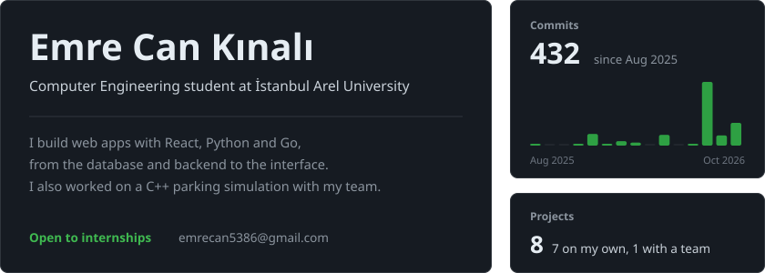
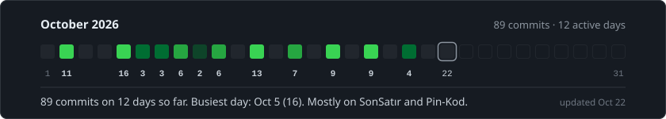
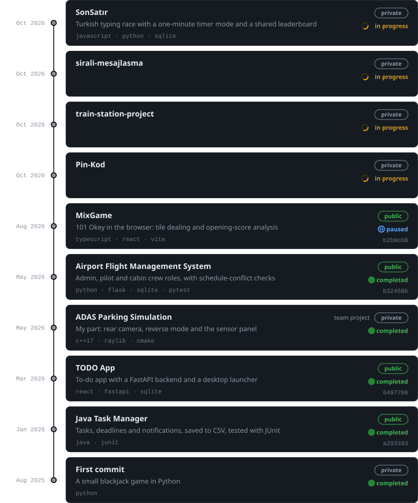
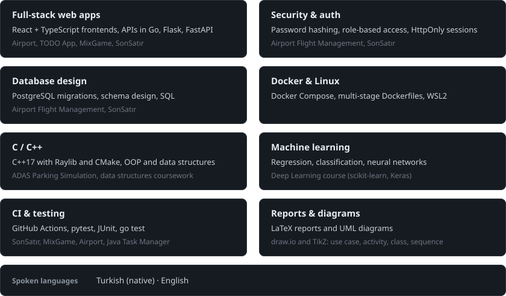
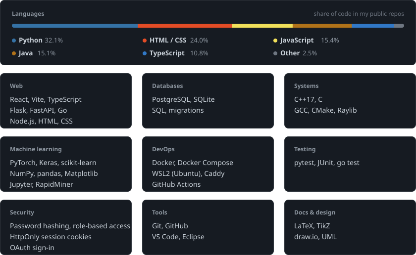

<!-- Generated by scripts/build_profile.py. Edit profile.json instead. -->
<picture>
  <source media="(prefers-color-scheme: dark)" srcset="assets/hero.svg"/>
  <source media="(prefers-color-scheme: light)" srcset="assets/hero-light.svg"/>
  
</picture>

  <a href="mailto:emrecan5386@gmail.com">Email</a> &nbsp;·&nbsp;
  <a href="https://github.com/kinaliemre?tab=repositories">Repositories</a>

 

<h3>This month</h3>

<picture>
  <source media="(prefers-color-scheme: dark)" srcset="assets/activity.svg"/>
  <source media="(prefers-color-scheme: light)" srcset="assets/activity-light.svg"/>
  
</picture>

 

<h3>History</h3>

<picture>
  <source media="(prefers-color-scheme: dark)" srcset="assets/history.svg"/>
  <source media="(prefers-color-scheme: light)" srcset="assets/history-light.svg"/>
  
</picture>

  
    <a href="https://github.com/kinaliemre/Airport-Flight-Management-System">Airport Flight Management System</a> &nbsp;·&nbsp;
    <a href="https://github.com/kinaliemre/TODO--APP">TODO App</a> &nbsp;·&nbsp;
    <a href="https://github.com/kinaliemre/JavaProje">Java Task Manager</a> &nbsp;·&nbsp;
    <a href="https://github.com/kinaliemre/MixGame">MixGame</a>
  

 

<h3>Skills</h3>

<picture>
  <source media="(prefers-color-scheme: dark)" srcset="assets/skills.svg"/>
  <source media="(prefers-color-scheme: light)" srcset="assets/skills-light.svg"/>
  
</picture>

 

<h3>Stack</h3>

<picture>
  <source media="(prefers-color-scheme: dark)" srcset="assets/stack.svg"/>
  <source media="(prefers-color-scheme: light)" srcset="assets/stack-light.svg"/>
  
</picture>
